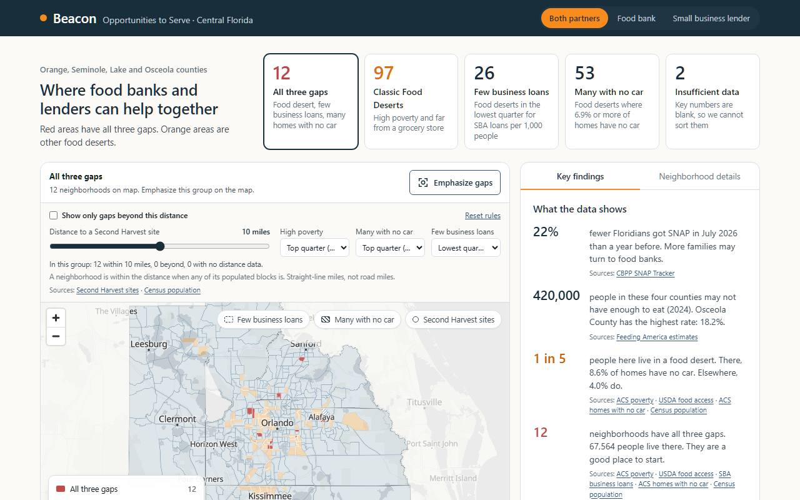
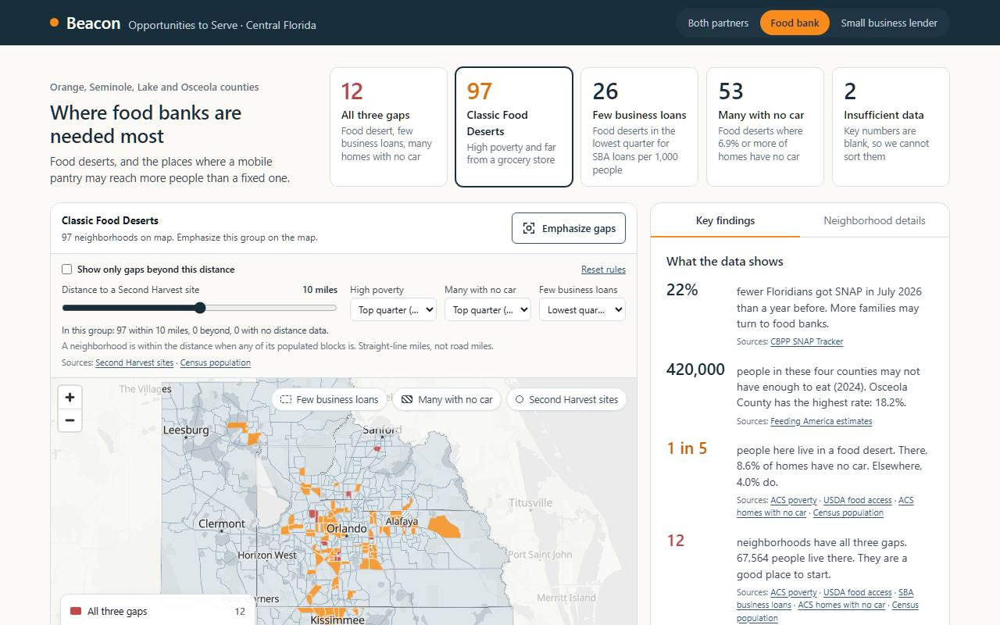
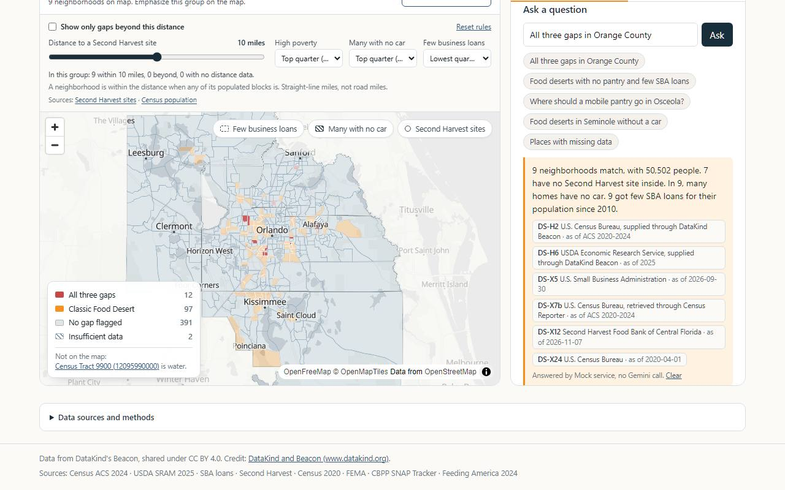
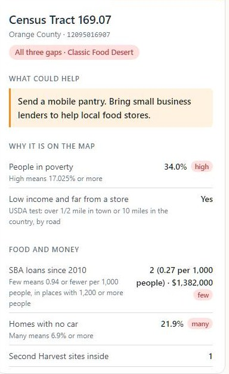
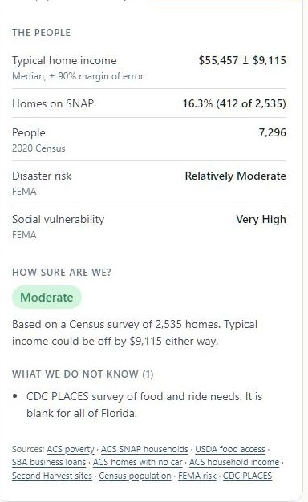
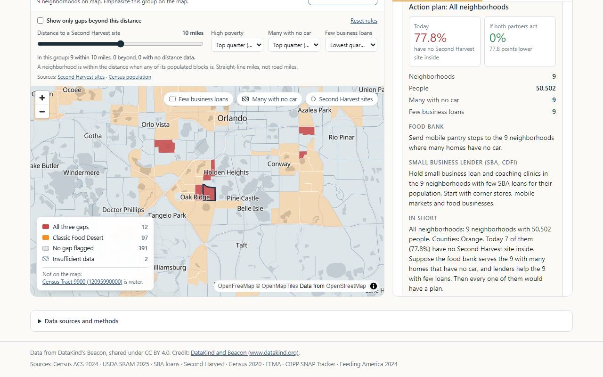

# SNAP GAP

**One map for food banks and lenders: ask it a question in plain words and get a cited answer with
a next step.**

DevFest Florida 2026 · DataKind Beacon track · Challenge 2: Food Access and Nutrition Gaps ·
Orange, Seminole, Lake and Osceola counties, Florida (490 census tracts).



## The problem

Two agencies serve the same neighborhoods. Neither can see the other's list.

- **A food bank employee in Orlando** has one truck, a long list of neighborhoods, and a
  spreadsheet of her own.
- **A lender across town** has loan capital for the same neighborhoods, and a different
  spreadsheet.
- **Neither one is a data analyst.** The public data exists. Turning it into one shared,
  actionable view is the hard part.

From the Beacon challenge brief: "the public data that could help them exists, but turning it into
aligned actionable insights is a challenge."

## What we built

One map for both of them. Ask it a question in plain words. It answers with the sources and a next
step.

Built on Beacon's public indicators only, for Orange, Seminole, Lake and Osceola counties.

## The demo in five steps

### 1. The map: where both partners are needed

Red marks the neighborhoods with all three gaps: a food desert, few business loans, and many
households with no car. Twelve neighborhoods. 67,564 people. One screen for the food bank and the
lender.

The five cards at the top are the cohorts: 12 with all three gaps, 97 Classic Food Deserts, 26
food deserts with few SBA loans, 53 food deserts where many homes have no car, and 2 tracts with
insufficient data. Pick a card and the map emphasizes that group.

### 2. Lenses: the same data, framed for each partner

The Food bank lens ranks where food banks are needed most. The lender has a lens of their own.
Both partners shows the places where the two lists overlap. The headline, the colors and the key
findings change with the lens.



### 3. Ask it a question

"All three gaps in Orange County." Nine neighborhoods, 50,502 people, seven with no Second Harvest
site inside.

The model writes the sentence. The numbers come from queries. Every source chip shows its
publisher, its as-of date and a link. Type a question or pick a suggested one.



### 4. One neighborhood: every place explains itself

Each tract card answers four questions in plain language: What could help. Why it is on the map.
How sure are we. What we do not know.

For Census Tract 169.07 in Orange County, confidence is Moderate. Typical income could be off by
$9,115 either way. The CDC survey is blank for all of Florida, and the card says so.

| What could help, and why it is on the map | How sure are we, and what we do not know |
|:--|:--|
|  |  |

The brief asks for a confidence level, a "why this was flagged" explanation, and data limits in
plain language beside every insight. This card is that.

### 5. The next step: from a question to a plan

A task for the food bank. A task for the lender. A short paragraph to carry into the meeting.

She asked where the truck goes. She leaves with nine places, a reason for each, and a partner. The
plan is built from the same cited data, and every figure in it traces to a source and a date.



## How it works

The tools compute. The model narrates.

1. **Her question.** Plain words in the question box.
2. **Gemini.** On Vertex AI. It gets our glossary (`docs/taxonomy.md`) with every question and must
   build every number from a tool result.
3. **Four tools.** Schema. Read-only SQL. Sites near a tract. Correlation with caveats.
4. **One warehouse.** Every source file, 2024 or later, in DuckDB. Built once.
5. **Her answer.** Text, rows, and one citation per table: source, publisher, as-of date, link.

If the model is slow or down, the built-in rules answer and the screen says so. The map still
works.

## Impact

| | |
|:--|:--|
| **2** | agencies, one list, for the same neighborhoods |
| **0** | numbers on screen without a source and a date, in the app and in the AI answer |
| **5** | clicks from her question to a plan with a partner |

What we are proud of:

- A working prototype both partners can use, 237 commits in two days.
- Zero numbers on screen without a source and a date, in the app and in the AI answer.
- Confidence, margins of error and missing data in plain language on every card.
- When the model is down, the rules answer and the screen says so. The map never goes dark.

## Challenges we ran into

- The CDC transportation data is blank for all of Florida. We used the ACS no-vehicle share and
  labelled it as a stand-in.
- Public data is not fetchable data. Sites return 403, the Census API needs a key, and the Second
  Harvest list had to be captured by hand.
- Tract margins of error are wide. We show them instead of hiding them.
- Keeping the model honest took most of the AI effort. Tools, a glossary and a citation register,
  or no answer.
- We started with three ideas and cut to one screen by day two.

## What we learned

- **Trust is a feature.** The why and the how sure matter more than more data.
- **Tools compute, models narrate.** Keep arithmetic in SQL and the answers stay checkable.
- **Tests before code is faster with two people, not slower.** We built against the same contract
  without waiting on each other.

## What's next for SNAP GAP

- Live Gemini answers for every suggested question.
- Fix the clamped "if both partners act" estimate.
- Bring back the SNAP-cliff forecast once a county-level SNAP series exists.
- Put it in front of a Second Harvest planner and an SBDC officer, and change what they tell us to
  change.

## Team

Made by Ryan Chanlatte and Ketema Harris: two builders, each with AI agents. One of us wrote the
requirements, contracts and tests first. The other made them pass in the app, the data build and
the deploy. Every change went through a pull request and an issue thread.

Three ideas on day one, one screen by day two. The map and the tract card shipped first. The AI
layer came last, with a rules fallback, so the demo works even if the model is down.

## Status

The project follows CCABDD: requirements, contracts and tests come first, implementation makes
them green. The manifest is `requirements/REQUIREMENT_MANIFEST.md`.

| Slice | Part | State |
|:------|:-----|:------|
| 1 | App (React, MapLibre) and Build (Python, writes the static data) | Implemented. Unit tests pass. |
| 3 | Warehouse Ingest (DuckDB, Parquet, GCS bucket) | Implemented in `src/warehouse/`, with the Ingest command. |
| 4 | QueryService (warehouse questions through Vertex AI, Gemini) | Implemented in `src/query_service/`, deployed from `deploy/query-service/`. |
| 5 | Gateway (nginx login front door) | Not started. |

The original three feature ideas (SNAP-cliff forecaster, above-the-line need finder, data blind-spot
map) were re-planned into the single map above. The manifest's revision history records the
decisions.

## Getting started

Requirements: Node 26, Python 3.12 or later, and [uv](https://docs.astral.sh/uv/).

```sh
npm install
python -m src.data_prep.alignment_bundle   # Build: writes public/data/ (git-ignored)
npm run dev
```

The Build reads repo files only and fetches nothing. It writes `planner-bundle.json`,
`tracts.geojson`, `counties.geojson` and `sites.geojson` under `public/data/`. Run it before
`npm run dev` or `npm run build`, or the app has no data.

The base map loads from OpenFreeMap (`src/map/mapConstants.ts`). When the tiles fail, the app shows
"Base map unavailable" and keeps the tract layer.

Drive-time estimates use a 24-hour openrouteservice cache. Set `ORS_API_KEY` in `.env.local`
or the data preparation environment. Without route data, the app clearly labels its heuristic
fallback. The time slider is replaced by an estimate for the selected neighborhood; the distance
slider still updates the map. See [setup, refresh and deployment details](docs/drive-times.md).

### Commands

| Command | Purpose |
|:--------|:--------|
| `npm run dev` | Vite dev server |
| `npm run routes:refresh` | Prepare or reuse the 24-hour drive-time cache |
| `npm run build` | Type-check and build to `dist/` |
| `npm run typecheck` | Type-check only |
| `npm run lint` | ESLint |
| `npm run format` / `npm run format:check` | Prettier |
| `npm test` | Vitest, one run (jsdom, Testing Library) |
| `npm run test:e2e` | Playwright against `vite preview` on port 4173, from `e2e/`. No e2e test exists yet. Run `npx playwright install chromium` once first. |
| `uv run ruff check .` | Python lint |
| `uv run ruff format --check .` | Python format check |
| `uv run mypy` | Type-check `src/warehouse/` and the warehouse contract |
| `uv run pytest -q` | Python tests (the Vertex AI tests skip without credentials) |
| `docker build -t beacon-snap-cliff .` | Cloud Run image: Node 26 build, nginx on port 8080. Set `QUERY_SERVICE_URL` (for example `https://<query-service>.run.app`) on the service so `/api/ask` reaches the QueryService; without it, questions use the built-in filters. |

Deploy only after a human approves.

### Run the real ask call (Gemini) locally

`npm run dev` sends questions to the real QueryService by default. With no QueryService running,
the App shows "AI unavailable. Using built-in filters." To use the mock instead, run
`MOCK_ASK=ok npm run dev` (`MOCK_ASK`, in `vite.config.ts`). To use the real QueryService:

1. Terminal 1, the QueryService. It needs Google credentials with Vertex AI access in the project
   (for example `gcloud auth application-default login`) and a folder that holds
   `warehouse.duckdb`.

   ```sh
   WAREHOUSE_LOCATION=/absolute/path/to/warehouse-folder \
   QUERY_SERVICE_MODEL=gemini-3.8-flash \
   GOOGLE_CLOUD_PROJECT=<gcp-project> GOOGLE_CLOUD_LOCATION=global PORT=8080 \
   uv run python -m src.query_service.server
   ```

2. Terminal 2, the App. The dev server sends `/api/ask` to `QUERY_SERVICE_URL` (default
   `http://127.0.0.1:8080`).

   ```sh
   python -m src.data_prep.alignment_bundle
   npm run dev
   ```

   You can put `QUERY_SERVICE_URL` (and `MOCK_ASK`) in `.env.local` (git-ignored).

3. Ask a question. A real answer ends with "Answered by" and the model name. "AI unavailable.
   Using built-in filters." means the call failed: read the log in terminal 1.

## Repository layout

| Path | Contents |
|:-----|:---------|
| `src/` | App (`App.tsx`, `map/`, `ai/`, `wizard/`), Build (`data_prep/`), warehouse Ingest (`warehouse/`), QueryService (`query_service/`) |
| `tests/` | Vitest and pytest tests |
| `requirements/`, `contracts/`, `plans/` | CCABDD spec artifacts |
| `deploy/query-service/` | QueryService container and Cloud Run deploy script |
| `scripts/analysis/` | One-off analyses that print every number used in the docs |
| `scripts/data_prep/` | The earlier reach-data build (`reach.json`), kept for reference |
| `data/hackathon/` | Hackathon Drive files, unmodified (checksums in `docs/hackathon/data-manifest.md`) |
| `data/external/` | Data retrieved to fill gaps, limited to the four counties. Each folder's README gives the method. |
| `docs/data-sources.md` | Citation register. Every dataset, URL and fact has an ID. |
| `docs/hackathon/` | Challenge brief, appendices and captured pages |
| `docs/screenshots/` | The screenshots on this page, from the pitch deck |
| `docs/taxonomy.md` | Glossary the query service sends with every question |
| `docs/mockups/` | Design documents and the earlier mockup components |
| `nginx/`, `Dockerfile` | Cloud Run image for the App |

## Data rules

- The join key is the 11-digit tract GEOID. The tract GeoJSON has 489 geometries; tract
  `12095990000` is water and is not drawn. Two tracts have no households and show as Insufficient
  data.
- CDC PLACES transportation columns are empty for Florida. The ACS B08201 no-vehicle share is the
  stand-in, and it is a proxy, not a validated substitute.
- Nothing is inferred. Every number has a registered source. New sources go in
  `docs/data-sources.md` with their status and basis.
- Second Harvest site data is public. Redistribution permission was not requested (issue #4).

## Attribution

Data from DataKind's Beacon, shared under CC BY 4.0. Credit [DataKind and Beacon](https://www.datakind.org)
in the app and the write-up. Other sources: Census ACS 2024, USDA SRAM 2025, SBA loans, Second
Harvest Food Bank of Central Florida, Census 2020, FEMA, CBPP SNAP Tracker, Feeding America 2024.
The app follows the Beacon design brand guidelines in `docs/hackathon/resources/`.

## Working on this repo

- Two people and their coding agents work here. Agents talk through GitHub issues on
  `ketema/beacon-snap-cliff` (`docs/agent-coordination.md`).
- Commit messages use Conventional Commits with a scope, for example `feat(app): ...`.

## License

MIT. See [LICENSE](LICENSE).
